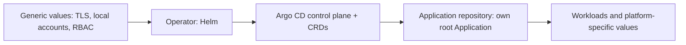

# Generic Argo CD installation by Helm

Source: [Argo CD Helm and RBAC blog](../argocd-rbac.md).

This is a **generic** local Kubernetes example. Use it on kind or another
Kubernetes distribution. No application-specific repository credentials,
Applications, Helm charts or cluster names belong in this guide.

## Version and security baseline

- Chart: `argo-cd` **10.15.0**, application **Argo CD v3.6.1**, checked
  15 November 2026 against upstream package metadata.
- Local non-HA install; suitable for a disposable learning environment.
- Kubernetes 1.34 is the chosen lab baseline, but check upstream chart and
  Kubernetes API compatibility before installation.
- HTTPS is enabled on Argo CD server; use local port-forwarding, not an
  Internet-facing ingress. The first-login self-signed certificate may need
  local trust configuration.
- RBAC: `policy.default: role:readonly` for the tutorial; local
  `learner` gets **get/sync** for Applications in the `default` project
  through `role:lab-operator`. This is **not production least-privilege**:
  the built-in read-only default is broader than a restrictive deny-by-default
  design. Review policies before sharing a cluster.
- No passwords, tokens or Git credentials are stored in Helm values.

## Explain: ownership



Helm installs and upgrades **Argo CD itself**. Afterwards, Argo CD
reconciles application Helm charts. **Do not** also manage this Argo CD
Helm release through another reconciler without a planned handover.

## Read-only preflight

```bash
# Pick the intended context. Confirm it before any changes.
kubectl config current-context
kubectl get nodes
helm version
helm list -A
kubectl get namespace argocd
kubectl get crd applications.argoproj.io
```

If Argo CD already exists, stop and review ownership/upgrade path.
Installing a Helm release over a kubectl-managed deployment can conflict
with resources and CRDs.

## Review the version-pinned chart (no cluster mutation)

From the `nks` repository root:

```bash
helm repo add argo https://argoproj.github.io/argo-helm
helm repo update
helm show chart argo/argo-cd --version 10.15.0
helm show values argo/argo-cd --version 10.15.0 > /tmp/argo-cd-upstream-values.yaml
helm template argocd argo/argo-cd --version 10.15.0 \
  --namespace argocd -f docs/argocd-helm/values.yaml \
  > /tmp/argocd-review.yaml
```

`helm repo add/update` changes your local Helm repository cache only.
Inspect generated resources, ClusterRoles, ClusterRoleBindings and CRDs
before any install. Note: Helm chart CRDs can require a separate upgrade
lifecycle. See upstream chart release notes.

## Install, after explicit cluster-level approval

```bash
# Replace with your actual target Kubernetes context.
CONTEXT="$(kubectl config current-context)"
kubectl --context "$CONTEXT" get nodes

# One Helm release owns the Argo CD control plane.
helm upgrade --install argocd argo/argo-cd \
  --version 10.15.0 \
  --kube-context "$CONTEXT" \
  --namespace argocd --create-namespace \
  -f docs/argocd-helm/values.yaml \
  --wait --timeout 10m
```

This creates/updates cluster RBAC, CRDs, Services, Deployments and Secrets.
Always review the live plan and chart dependencies before running it.

## Verify and access

```bash
kubectl --context "$CONTEXT" -n argocd get pods,svc
kubectl --context "$CONTEXT" -n argocd rollout status deployment/argocd-server --timeout=300s
kubectl --context "$CONTEXT" -n argocd rollout status deployment/argocd-repo-server --timeout=300s
kubectl --context "$CONTEXT" -n argocd port-forward svc/argocd-server 8080:443
```

Use a second terminal for login. The initial admin secret should be read
only in your terminal, never committed or pasted into logs. Follow the
[official first login guide](https://argo-cd.readthedocs.io/en/stable/getting_started/#4-login-using-the-cli).
Install an **exact-version** Argo CD CLI matching the installed server.
Use the browser at `https://localhost:8080`.

For a fresh lab, the initial admin is only for setting up credentials,
testing RBAC and repository access. Change its password, then disable it
when a tested alternative administrator exists. Enable API tokens for
individual accounts only if needed; do not add `apiKey` automatically.

## Check RBAC, including denied behavior

The values file creates local account `learner` with login capability.
Set a unique password interactively in Argo CD, then authenticate as
that account. To test the installed policy, use the CLI and expect:

```bash
# Requires an authenticated Argo CD CLI session.
argocd account can-i get applications 'default/example'
argocd account can-i sync applications 'default/example'
argocd account can-i delete applications 'default/example'
```

The first two should be **yes** for `learner` and the third **no**
(subject to built-in default permissions). Do not grant the account
`role:admin` simply to make a sync test pass.
For production, prefer OIDC/SSO, explicit scoped projects, minimal
`policy.default`, auditable groups and credential rotation.

## Upgrade and cleanup boundaries

- Changes to `docs/argocd-helm/values.yaml` affect only the **Argo CD
  control plane**, not application Helm values.
- Before any chart upgrade, read chart changes/CRD migration and
  `helm diff`; back up Helm release state and Argo CD config.
- Keep application secrets and controller login passwords outside Git.
- Do not uninstall Argo CD while it manages active Applications.
  Uninstall/cluster deletion are destructive and require separate approval.

## References

- https://github.com/argoproj/argo-helm/tree/main/charts/argo-cd
- https://argo-cd.readthedocs.io/en/stable/operator-manual/rbac/
- https://argo-cd.readthedocs.io/en/stable/operator-manual/user-management/
- https://argo-cd.readthedocs.io/en/stable/getting_started/
