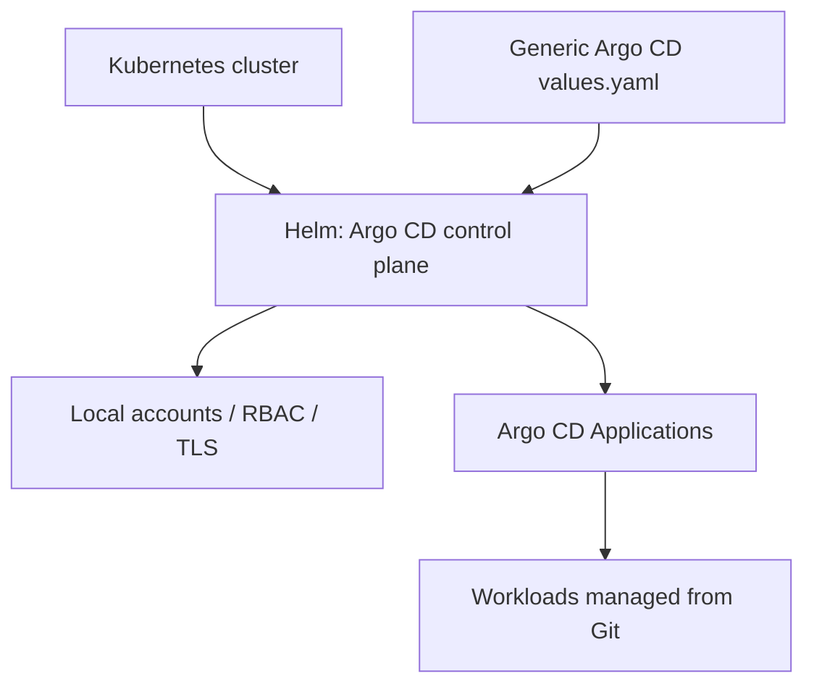

# Setting up Argo CD on Kubernetes with Helm, local users and RBAC


This is a **generic Kubernetes tutorial**, suitable for a disposable kind
cluster, Talos or EKS with an appropriately reviewed configuration.

**Updated 15 November 2026:** The earlier article installed the moving
`stable` raw manifest, patched `--insecure`, downloaded an unpinned CLI,
and contained placeholder passwords on command lines. The recommended
installation is now a **version-pinned Helm release**, with TLS kept
enabled, configurable RBAC and no stored account passwords.

**Start here:**
[Complete Helm installation and RBAC runbook](argocd-helm/README.md)
and [versioned values.yaml](argocd-helm/values.yaml).

## Architecture



## 1. Review and render locally

The pinned learning baseline is the **argo-cd chart 10.15.0**
with **Argo CD v3.6.1**. Check the upstream release notes for future
clusters and upgrades.

```bash
helm repo add argo https://argoproj.github.io/argo-helm
helm repo update

helm show chart argo/argo-cd --version 10.15.0

helm template argocd argo/argo-cd \
  --version 10.15.0 --namespace argocd \
  -f docs/argocd-helm/values.yaml > /tmp/argocd-review.yaml
```

Review rendered ClusterRoles, CRDs, Services, image versions and
resource requests. These commands do not modify Kubernetes.

## 2. Install after approval

```bash
CONTEXT="$(kubectl config current-context)"
kubectl --context "$CONTEXT" get nodes

helm upgrade --install argocd argo/argo-cd \
  --version 10.15.0 --kube-context "$CONTEXT" \
  --namespace argocd --create-namespace \
  -f docs/argocd-helm/values.yaml --wait --timeout 10m
```

The Helm release manages Argo CD's Kubernetes resources. Use Helm for
future Argo CD upgrades, not both Helm and raw `kubectl apply`.

## 3. Access and verify

```bash
kubectl --context "$CONTEXT" -n argocd get pods,svc
kubectl --context "$CONTEXT" -n argocd rollout status deploy/argocd-server
kubectl --context "$CONTEXT" -n argocd \
  port-forward svc/argocd-server 8080:443
```

Open `https://localhost:8080`. The initial certificate may be
self-signed. Retrieve the one-time admin password **locally**, following
[Argo CD's first-login procedure](https://argo-cd.readthedocs.io/en/stable/getting_started/#4-login-using-the-cli),
and rotate it. Do not publish login output.

## 4. Local user and RBAC exercise

The generic [values file](argocd-helm/values.yaml) creates a local
`learner` login account and defines an example `lab-operator` role
for read/sync operations in the `default` AppProject.

- Use the Argo CD CLI to set a **unique interactive password** for the
  account; never place one in Helm YAML or shell command history.
- Validate allowed `get`/`sync` and denied `delete` for this
  account. A user with `role:admin` is not a good test of limited RBAC.
- `policy.default` is configured in `argocd-rbac-cm` through the
  Helm chart `configs.rbac` values, **not** in `argocd-cm`.
- The tutorial's `role:readonly` default and `default` project
  are convenient for a personal lab, not a secure multi-tenant policy.
  For production, design least privilege, scoped projects and SSO.

## 5. Application deployment is a separate concern

This guide installs **Argo CD itself**. Deploying applications, adding
private repository credentials and configuring their Helm values belongs
to the owning application repositories.

Do **not** execute unreviewed `curl | bash` application installers.

For rollout checks, CRD upgrades, rollback and safe cleanup see
[the full runbook](argocd-helm/README.md).

## References

- [Official Argo CD Helm chart](https://github.com/argoproj/argo-helm/tree/main/charts/argo-cd)
- [Argo CD RBAC documentation](https://argo-cd.readthedocs.io/en/stable/operator-manual/rbac/)
- [Argo CD local users](https://argo-cd.readthedocs.io/en/stable/operator-manual/user-management/)
