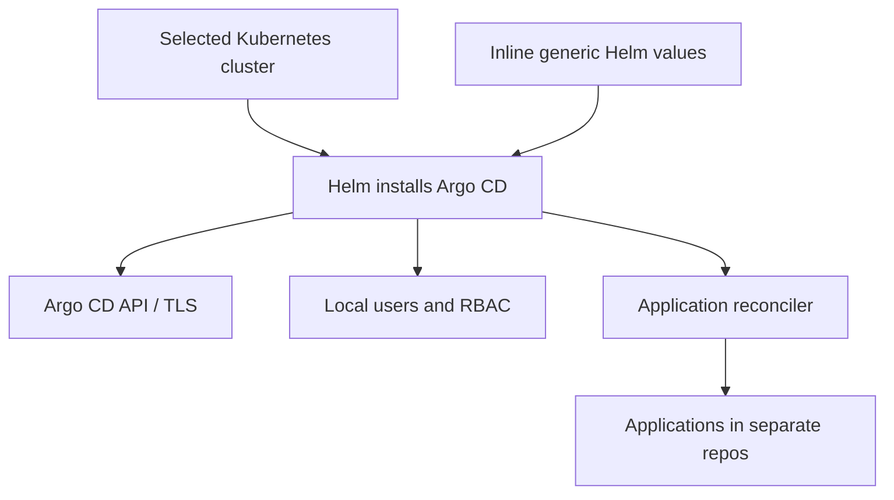

# Install Argo CD via Helm, configure local users and RBAC


A **generic Kubernetes** tutorial for kind, Talos, EKS or other conformant
clusters. This article is self-contained: no additional YAML or README is
required in the NKS repository. Application-specific deployment belongs in
the corresponding application repository.

**Lab baseline (15 November 2026):** Argo CD Helm chart `10.15.0`,
Argo CD `v3.6.1`. These are selected versions, not an automatic
latest-version policy. Check the chart metadata and release notes before
running. This example is non-HA and assumes a Kubernetes 1.34 lab cluster.

## Architecture



Helm owns the **Argo CD control plane**. Argo CD owns the **application
resources**, such as Helm-rendered workloads. Never use a raw installer and
Helm concurrently to manage the same Argo CD release.

## 1. Read-only environment review

```bash
kubectl config current-context
kubectl get nodes
kubectl get namespace argocd
kubectl get crd applications.argoproj.io
helm version
helm list -A
```

If Argo CD is already installed, stop and review its current release owner.
This article assumes a new installation. Confirm that the selected context
is the target before doing anything that changes Kubernetes.

## 2. Choose a pinned chart and review inline values

```bash
ARGOCD_CHART_VERSION=10.15.0
CONTEXT="$(kubectl config current-context)"

helm repo add argo https://argoproj.github.io/argo-helm
helm repo update
helm show chart argo/argo-cd --version "$ARGOCD_CHART_VERSION"
```

For this learning exercise, create a **temporary local file** from this
article, not a configuration file in the NKS repository. The `trap`
deletes it when the terminal session exits.

```bash
ARGOCD_VALUES="$(mktemp)"
chmod 600 "$ARGOCD_VALUES"
trap 'rm -f "$ARGOCD_VALUES"' EXIT

cat > "$ARGOCD_VALUES" <<'YAML'
# Generic local-lab settings. No application-specific configuration.
global:
  domain: localhost
server:
  service:
    type: ClusterIP
  ingress:
    enabled: false
configs:
  params:
    server.insecure: false
  cm:
    admin.enabled: true
    users.anonymous.enabled: false
    accounts.learner: login
  rbac:
    policy.default: role:readonly
    policy.csv: |
      p, role:lab-operator, applications, get, default/*, allow
      p, role:lab-operator, applications, sync, default/*, allow
      g, learner, role:lab-operator
YAML

helm template argocd argo/argo-cd \
  --version "$ARGOCD_CHART_VERSION" \
  --namespace argocd -f "$ARGOCD_VALUES" \
  > /tmp/argocd-rendered.yaml
```

Inspect the generated manifests for image versions, resources,
ClusterRoles, ClusterRoleBindings, CRDs and Services.
The commands so far only modify the local Helm cache and temporary
files, **not Kubernetes**.

`policy.default: role:readonly` is intentionally permissive for a
single-user learning lab. It applies broad read-only permissions, so
**do not mistake this for deny-by-default production RBAC**.
The local account `learner` has interactive login only; it has no
API-token capability unless added explicitly.

## 3. Install after explicit approval

Run these commands in the **same shell** as Section 2, where
`ARGOCD_CHART_VERSION`, `CONTEXT` and `ARGOCD_VALUES` exist.

```bash
kubectl --context "$CONTEXT" get nodes

helm upgrade --install argocd argo/argo-cd \
  --version "$ARGOCD_CHART_VERSION" \
  --kube-context "$CONTEXT" \
  --namespace argocd --create-namespace \
  -f "$ARGOCD_VALUES" \
  --wait --timeout 10m
```

This installs Argo CD CRDs, controllers, Services and RBAC.
Do not run it without approval or against an unrelated kubeconfig
context. For upgrades, review Helm chart migration and CRD changes
before running `helm upgrade`.

## 4. Verify and access over local TLS

```bash
kubectl --context "$CONTEXT" -n argocd get pods,svc
kubectl --context "$CONTEXT" -n argocd rollout status deployment/argocd-server --timeout=300s
kubectl --context "$CONTEXT" -n argocd rollout status deployment/argocd-repo-server --timeout=300s
kubectl --context "$CONTEXT" -n argocd port-forward svc/argocd-server 8080:443
```

Open `https://localhost:8080`. The initial certificate may be self-signed.
In a second terminal, follow the
[official first-login instructions](https://argo-cd.readthedocs.io/en/stable/getting_started/#4-login-using-the-cli)
to get the initial administrator credential and rotate it. Do not paste
passwords into the article, Git, shell command arguments or issue logs.
Use a version-matched Argo CD CLI; inspect its download and checksum
before installing. Keep TLS enabled in the Argo CD server; a local CLI
may need a documented trust exception for the self-signed lab certificate.

## 5. Local accounts and RBAC checks

The Helm inline values create account `learner`. Set a unique password
using the authenticated Argo CD CLI's interactive password prompts.
Log in as `learner` and verify the effective permissions:

```bash
# Use an authenticated CLI session for the learner account.
argocd account can-i get applications 'default/example'
argocd account can-i sync applications 'default/example'
argocd account can-i delete applications 'default/example'
```

The intended results are **yes**, **yes**, **no**. Validate actual
behavior before claiming access restrictions are working.
`configs.rbac.policy.default` belongs to the Argo CD RBAC ConfigMap,
not the general Argo CD ConfigMap.
Do not assign `role:admin` merely to make a test pass.
For shared/production clusters, use SSO/OIDC, scoped AppProjects and
a restrictive default policy, plus credential rotation and auditing.

## 6. Upgrade, rollback and teardown boundaries

- Check upstream Helm chart release notes, breaking changes and CRD
  upgrade requirements before changing the pinned chart version.
- Capture existing chart version, `helm get values` and relevant
  Kubernetes state before upgrades; `helm rollback` does not
  necessarily reverse CRD schema migrations.
- Do not uninstall Argo CD while it owns live Applications.
- Data deletion, cluster cleanup and Helm uninstall require a
  separate explicit approval.

## References

- [Argo CD Helm chart](https://github.com/argoproj/argo-helm/tree/main/charts/argo-cd)
- [Argo CD installation](https://argo-cd.readthedocs.io/en/stable/getting_started/)
- [RBAC](https://argo-cd.readthedocs.io/en/stable/operator-manual/rbac/)
- [Local accounts](https://argo-cd.readthedocs.io/en/stable/operator-manual/user-management/)
