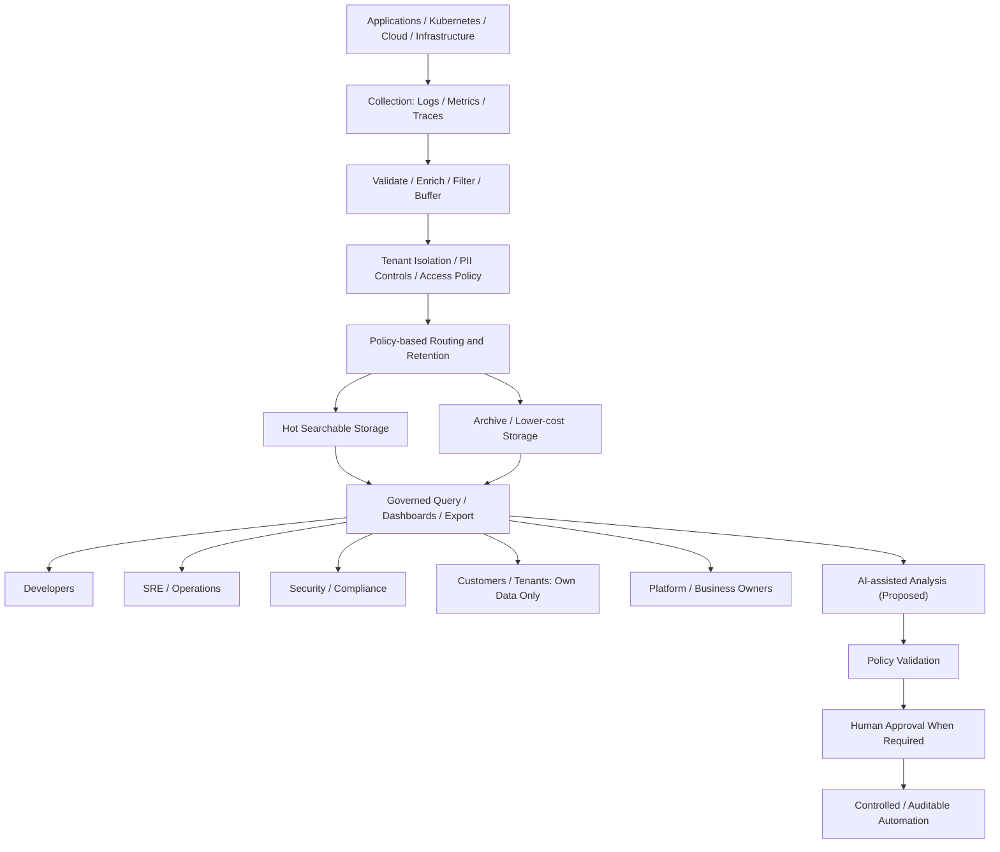

# Enterprise Observability at Scale: The Right Data, People, Retention, Cost and Control

Enterprise observability is not just a technology stack for collecting logs, metrics and traces. It is a shared operational capability that must meet different needs without compromising security, reliability or cost.

## Objective

Explore the architecture choices behind multi-stakeholder observability in distributed and multi-tenant platforms, including tenant isolation, retention, resilience and AI-assisted analysis under human control. This is a conceptual design discussion, not a claim of a deployed end-to-end implementation.

## Who is the platform for?

| Consumer | Primary need | Critical boundary |
| --- | --- | --- |
| Developers | Debugging and traces | Application-scoped access |
| SRE and operations | SLOs, alerts and end-to-end diagnostics | Reliable cross-system correlation |
| Security and compliance | Audit evidence and investigations | Restricted access, integrity and retention obligations |
| Customers and tenants | Their own service logs and operational insights | Strict tenant separation and authorized exports |
| Platform and business owners | Reliability and cost allocation | Usage, ownership and budget visibility |

## Architecture decisions

1. **Collection and signal quality.** Decide which logs, metrics and traces are needed. Filter redundant signals without removing evidence needed for incidents or compliance.
2. **Identity and data isolation.** Carry trusted tenant and workload context through ingestion, routing, storage and query. Labels alone are not an authorization mechanism. Apply least privilege and defend against cross-tenant reads.
3. **Retention and cost.** Separate interactive, archived and deletion paths. Treat customer contracts, incident needs and legal requirements as inputs to retention, rather than selecting one global duration.
4. **Pipeline resilience.** Account for source outages, bounded queues, retries, duplicate delivery, failed exports, backpressure and observable loss. Document which guarantees are actually supported.
5. **Operational outcomes.** Measure useful incident diagnosis, alert quality, SLO coverage and recovery rather than raw data volume.
6. **Customer delivery.** Support scoped views and, where required, secure exports into customer-owned observability or security systems.

## Conceptual architecture

The diagram is conceptual. An actual design needs trust-boundary enforcement, capacity modelling, failure testing and verification of each storage and export backend.

## Where AI might help

AI-assisted signal correlation, incident summaries and retention recommendations are promising areas to explore, not capabilities claimed here as production deployments.

A bounded flow would be:

`Telemetry → AI-assisted reasoning → Policy validation → Human approval when needed → Deterministic, auditable action`

Access policy, legal retention, sensitive-data disclosure and high-impact remediation must remain under explicit governance. Generated recommendations should carry evidence and be reviewable.

## Trade-offs worth testing

- Can a tenant retrieve another tenant's records through shared indexes, dashboards or exports?
- When the downstream storage fails, what is retried, dropped, buffered or duplicated?
- Does filtering improve useful signal quality without removing investigation evidence?
- Which data really benefits from hot indexing, and who owns the cost?
- Can an AI recommendation be traced to observations and blocked safely?

## References and related reading

- [Guidewire Engineering: Log Management and Guidewire Cloud Platform Observability](https://medium.com/guidewire-engineering-blog/log-management-and-guidewire-cloud-platform-observability-73a033a34e9a)
- [Published LinkedIn discussion](https://www.linkedin.com/feed/update/urn:li:activity:7519783091092099073/)

This article presents general architecture principles, informed by experience with Kubernetes, distributed monitoring and centralized logging. It does not reproduce or claim implementation of Guidewire's design.
