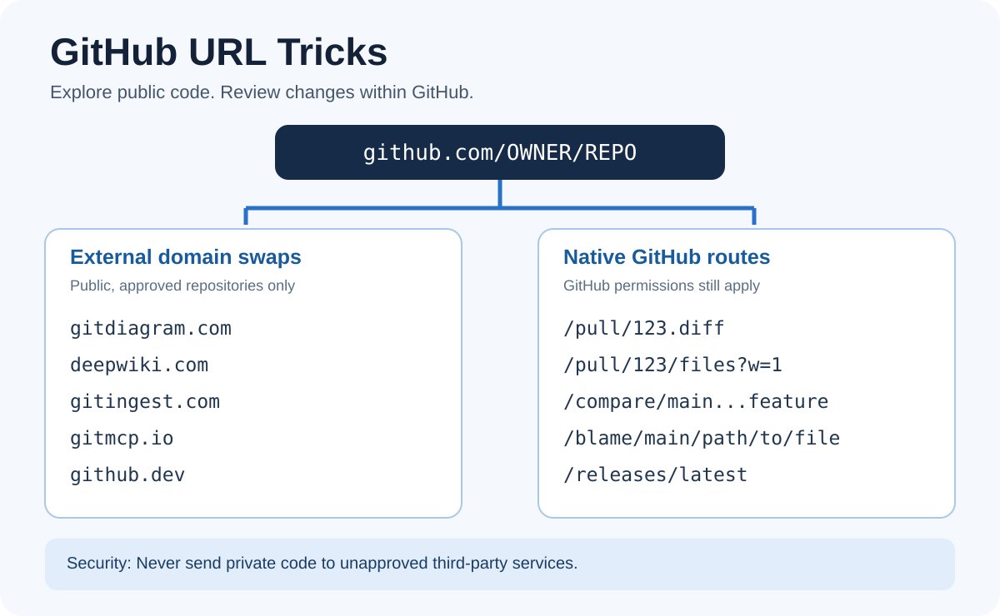

# GitHub URL Tricks: Review Smarter, Navigate Faster

Published: 2026-11-22

A small change in a GitHub URL can save several clicks during a platform engineering review. I use these patterns as a lightweight way to inspect changes, trace decisions and explore public source code.



## The Two Paths

GitHub URL tricks fall into two groups:

1. **External domain swaps** for public repositories. These send repository context to another service, so check its trust and access policy first.
2. **Native GitHub shortcuts** for working within GitHub's own authentication and repository permissions.

## Explore Public Repositories

Start with `https://github.com/OWNER/REPO`. For publicly shareable source, try:

| URL | What it helps with |
| --- | --- |
| `https://gitdiagram.com/OWNER/REPO` | Architecture visualization |
| `https://deepwiki.com/OWNER/REPO` | AI documentation and code exploration |
| `https://gitingest.com/OWNER/REPO` | LLM-friendly repository context |
| `https://gitmcp.io/OWNER/REPO` | MCP-enabled exploration with supported clients |
| `https://github.dev/OWNER/REPO` | Browser-based VS Code editor, with GitHub access controls |

Some services have limitations, costs or changing features. Verify each service before relying on it. On GitHub itself, pressing `.` opens the web editor.

## Review Faster With Native GitHub URLs

| Pattern | Outcome | Practical use |
| --- | --- | --- |
| `/pull/123.diff` | Unified PR diff | Focused code review |
| `/pull/123.patch` | Patch with commit metadata | Apply or study commits |
| `/commit/SHA.diff` | Unified commit diff | Audit one change |
| `/pull/123/files?w=1` | Hide whitespace-only changes | Review formatter-heavy PRs |
| `/compare/main...feature-branch` | Compare Git refs | Release and branch audit |
| `/blame/main/path/to/file` | Line-by-line history | Trace when a setting changed |
| `/releases/latest` | Latest full published release | Browse release notes |
| `https://github.com/USERNAME.keys` | A user's public SSH keys | Inspect registered keys |
| `https://github.com/USERNAME.gpg` | A user's public GPG keys | Inspect signing keys |

Paths in the first seven rows follow `https://github.com/OWNER/REPO`. The `USERNAME` URLs are **account-level paths** and must not be appended to a repository path.

## Examples I Would Use in Platform Engineering

Review a Terraform or Kubernetes change while ignoring formatting noise:

```text
https://github.com/OWNER/REPO/pull/123/files?w=1
```

Compare a release branch with the default branch:

```text
https://github.com/OWNER/REPO/compare/main...release
```

Trace the history of an Argo CD values file:

```text
https://github.com/OWNER/REPO/blame/main/path/to/values.yaml
```

For a **public** repository, download a patch and inspect it before applying:

```sh
curl -fL https://github.com/OWNER/REPO/pull/123.patch -o change.patch
less change.patch
git apply --check change.patch
```

For a private repository, prefer approved authenticated tools such as GitHub CLI or Git over embedding tokens in URLs or shell history.

## Security Notes

- Never submit private code or internal repository URLs to third-party AI services without authorization.
- Native GitHub URLs are **not** a guarantee of safety. GitHub permissions, review policy and data handling still matter.
- Downloaded patches are untrusted input. Read them before applying.
- A public SSH key alone is not an identity-verification process. Check ownership and fingerprints before trusting a key.
- `/releases/latest` means the most recent full release on GitHub, not necessarily the version approved for production.

## Key Takeaway

I prefer shortcuts that make a review easier to understand, not just faster to click. The domain bar is useful for exploration; native GitHub routes are useful when code and access boundaries matter.

Which URL pattern is already part of your engineering workflow?
