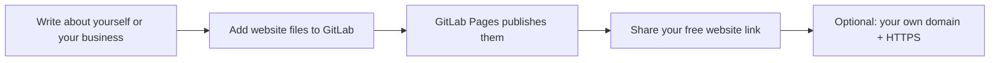

# Build Your First Website for Free: A Step-by-Step Guide with GitLab Pages

Drafted: 17-11-2026

Imagine a student who wants to show projects to recruiters, a baker who wants customers to find a menu, or a blogger who wants one place for their writing. All three need a simple web address they can share. They do not necessarily need a website builder subscription or a web developer.

In this guide, you will create a real one-page website from scratch and publish it with GitLab Pages. You can do everything from your browser. We'll use a free GitLab-provided web address first. Buying a domain is entirely optional.

## Objective

Help a first-time website owner create, publish and update a basic website without paying for a hosting server. By the end, you will know how to share the link and, if you own a domain, connect it safely with HTTPS.

## What are we creating, and why?

A **website** is a public page people can open using a link. A student can show projects to recruiters, a small shop can show opening hours and services, and a blogger can introduce their work.

You will create a **one-page website**. It is enough for an introduction, a few examples and a contact link. You can add more pages later.

| What you need | Why you need it | What you do |
| --- | --- | --- |
| Website content | Visitors need to know who you are and what you offer | Write a short introduction, add your work or services and a public contact link |
| Website files | Your browser needs instructions for the page | Copy the provided HTML, CSS and JavaScript into GitLab |
| GitLab account | A place to save and update the files | Create a free account and project |
| GitLab Pages | To make the website available on the internet | Add the small publishing file and check the public link |
| Domain name (optional) | A memorable address such as `www.example.com` | Buy or use a domain you already own, then connect it |
| HTTPS certificate | To help visitors connect securely | Use GitLab's managed certificate option for your custom domain |

**What are HTML, CSS and JavaScript?** HTML contains the words and sections of your page. CSS controls colors, spacing and layout. JavaScript makes simple interactions work, like a button that displays a message. You do not need to write these from scratch for this exercise.

## What will it cost?

The starter website can use GitLab Pages on the free tier, within its limits. You can share the GitLab-provided address without buying a domain. If you want a custom name, domain registration and renewal normally cost money.

## The simple publishing journey



You only need a browser and the instructions below. Build and test the free link first, then decide whether a custom domain is worth buying.

## Prerequisites

- A free [GitLab account](https://gitlab.com/).
- A web browser and access to edit a GitLab repository.
- Optional: a domain you control. Spaceship is used as an example, but any DNS provider works.
- No AWS account, Docker installation or local development tools required.

## Step 1: Create your free GitLab project

**What:** A project is an online folder for your website files. **Why:** It stores your work, tracks changes and lets GitLab publish updates. **How:** Follow these steps.

1. Open [Create new GitLab project](https://gitlab.com/projects/new).
2. Choose **Create blank project**.
3. Name it `my-first-website`, under your own namespace.
4. Initialize it with a README, then create the project.
5. Note the actual default branch name. It may be `main` or something else.

Think of this project as the home for your website files. Nothing is online yet. If you want to show others how you built your site, choose public visibility. Never add passwords or personal documents.

## Step 2: Make the page your visitors will see

**What:** This is the actual page visitors will open. **Why:** It tells people who you are and how to contact you. **How:** Copy the three example files below into the project.

In your new GitLab project, choose **New file** and add the paths below. Copy each example into the matching file. There is no software to install. If you prefer, you can also edit them on your computer.

```text
my-first-website/
├── .gitlab-ci.yml
└── public/
    ├── index.html
    ├── css/
    │   └── style.css
    └── js/
        └── main.js
```

**`public/index.html`**

```html
<!doctype html>
<html lang="en">
<head>
  <meta charset="utf-8">
  <meta name="viewport" content="width=device-width, initial-scale=1">
  <meta name="description" content="My first website hosted on GitLab Pages.">
  <title>My First Website</title>
  <link rel="stylesheet" href="css/style.css">
  <script src="js/main.js" defer></script>
</head>
<body>
  <header class="site-header">
    <a href="#home" class="brand">My First Website</a>
    <nav aria-label="Main navigation">
      <a href="#about">About</a>
      <a href="#contact">Contact</a>
    </nav>
  </header>
  <main id="home">
    <section class="hero">
      <p class="eyebrow">Welcome to my corner of the internet</p>
      <h1>Hello! I'm building something new.</h1>
      <p>Discover my work, my story, or the services I offer.</p>
      <button type="button" id="hello-button">Try the button</button>
      <p id="message" role="status" aria-live="polite"></p>
    </section>
    <section id="about" class="section">
      <h2>About this site</h2>
      <p>I'm using this space to introduce myself and share what I do.</p>
    </section>
    <section id="contact" class="section">
      <h2>Contact</h2>
      <p>Add a public email or social profile link here. Never share private details.</p>
    </section>
  </main>
  <footer>Made with GitLab Pages</footer>
</body>
</html>
```

**`public/css/style.css`**

```css
:root {
  color-scheme: light;
  font-family: system-ui, sans-serif;
  color: #15253d;
  background: #f7f9fc;
}
* { box-sizing: border-box; }
body { margin: 0; line-height: 1.6; }
.site-header {
  display: flex;
  justify-content: space-between;
  align-items: center;
  gap: 1rem;
  padding: 1rem max(1rem, calc((100vw - 960px) / 2));
  background: white;
  flex-wrap: wrap;
}
.brand { font-weight: 700; }
a { color: #185b97; }
nav { display: flex; gap: 1rem; }
.hero, .section {
  max-width: 960px;
  margin: auto;
  padding: 3rem 1rem;
}
.hero { padding-block: 5rem; }
.hero h1 { font-size: clamp(2rem, 5vw, 3.5rem); line-height: 1.2; }
.eyebrow { color: #32759c; font-weight: 700; }
button {
  background: #155e91;
  color: #fff;
  border: none;
  border-radius: .6rem;
  padding: .75rem 1.2rem;
  cursor: pointer;
  font: inherit;
}
button:focus-visible, a:focus-visible {
  outline: 3px solid #f4ad30;
  outline-offset: 3px;
}
footer { padding: 2rem 1rem; text-align: center; }
```

**`public/js/main.js`**

```javascript
const button = document.querySelector("#hello-button");
const message = document.querySelector("#message");
button?.addEventListener("click", () => {
  if (message) message.textContent = "It works! JavaScript is running.";
});
```

Because the CSS and JavaScript links are relative paths, they also work when GitLab serves your project under a subpath. In your browser, the page should have a styled header and a button that displays a message. You can open `public/index.html` locally to check the layout.

## Make it yours before publishing

You can personalize the same page without changing the technical setup:

- **Students:** Replace the headline with your name and add projects, skills and a LinkedIn link.
- **Small businesses:** Replace it with your business name and add your services, location or service area, and public contact details.
- **Bloggers:** Introduce your topic and add links to three favorite articles.

Change the text inside `index.html` and try a new button color inside `style.css`. Avoid uploading private documents or anything you would not want strangers to see.

## Step 3: Tell GitLab to publish your website

**What:** A publishing instruction file. **Why:** The files saved in GitLab are not automatically a public website. **How:** Add the small configuration below. GitLab runs it when you update the default branch.

Create **`.gitlab-ci.yml`** at the *repository root*:

```yaml
stages:
  - deploy

deploy-pages:
  stage: deploy
  script:
    - test -s public/index.html
  pages: true
  rules:
    - if: '$CI_COMMIT_BRANCH == $CI_DEFAULT_BRANCH'
```

You only need to copy this small file. It tells GitLab to check that your homepage exists and publish the contents of the `public` folder whenever you commit to the default branch. You can learn the technical details later.

Commit the new files to your default branch. For teams, use a feature branch and merge request first.

## Step 4: Open and share your free website

**What:** Your free public website link. **Why:** People should be able to open your page without a GitLab account. **How:** Let GitLab finish publishing, then copy the exact address from its Pages settings.

1. Open **Build → Pipelines** in GitLab.
2. Open the pipeline for your latest default-branch commit.
3. Confirm `deploy-pages` succeeds and the Pages deployment completes.
4. Open **Deploy → Pages** to get the exact URL GitLab assigned.
5. Open the URL in a private browser window.

A free GitLab Pages URL usually ends in `.gitlab.io`. The actual path and hostname depend on your project and Pages settings, including unique domains. **Copy the URL from GitLab rather than guessing it.**

Verify that:
- The heading **Hello! I'm building something new.** appears.
- The page has styling.
- The button displays the message.
- The page works on a phone-sized screen.
- The browser shows HTTPS.

At this point, the free website is complete. Everything below is optional.

## Step 5 (optional): Give your website your own domain name

**What is a domain?** It is the address people type, for example `www.example.com`. You already have a free website link, so buying one is optional.

**What does a domain provider do?** A registrar such as Spaceship or GoDaddy lets you register a name and renew it, usually for an annual fee. It does **not** automatically build or host your website. GitLab Pages hosts your files. **DNS** (Domain Name System) connects your domain name to that hosted website, much like an address book. The company where you bought the domain may also host DNS, but not always.

**Why connect a domain?** A short business or personal name can be easier to remember and print on a card or résumé. It is not required for publishing.

**How?** Add the domain in GitLab, copy its exact DNS instructions, and enter those records at your *authoritative DNS provider*. The example below uses Spaceship only when Spaceship is also managing the DNS records. You can use another provider.

Example custom hostname: `www.example.com`. Replace it with a subdomain that you own.

1. In GitLab, open **Deploy → Pages → Add domain** and enter the exact hostname.
2. Copy the domain verification `TXT` record displayed by GitLab.
3. Copy the GitLab Pages hostname or other DNS target specified for your site.
4. In Spaceship, open the domain's DNS management page **only if Spaceship is the authoritative DNS host**.
5. Before editing, record any existing DNS entries for that hostname.
6. Create or update the required `CNAME` for the subdomain, pointing to the GitLab Pages hostname, not a URL or a path.
7. Add the `TXT` record with the exact name and value GitLab generated.
8. Back in GitLab, retry domain verification when the records are visible.

Example shape, **not actual record values**:

| Record type | Hostname | Value |
| --- | --- | --- |
| CNAME | `www.example.com` | `YOUR-NAMESPACE.gitlab.io` |
| TXT | `_gitlab-pages-verification-code.www.example.com` | **Exact GitLab-generated token** |

DNS dashboards sometimes ask for only the short host label rather than the full domain. Check the preview so you do not accidentally create a doubled domain name. Do not overwrite existing production records without understanding what they serve.

For a root domain such as `example.com`, the DNS setup is different. Follow GitLab's documented A/AAAA or supported ALIAS guidance rather than assuming a root CNAME is valid.

## Step 6 (optional): Make sure your own domain has HTTPS

**What:** HTTPS is the secure connection used when visitors open an address beginning with `https://`. A certificate helps the browser verify the site it is connecting to.

**Why:** It helps protect data in transit and avoids browser security warnings caused by missing or invalid certificates. HTTPS does not, by itself, prove a business is trustworthy.

**How:** GitLab Pages on GitLab.com supports automatic Let's Encrypt certificates for verified custom domains. The free GitLab-provided URL already uses HTTPS.

1. Make sure the site loads on the custom hostname and domain ownership is verified.
2. Open **Deploy → Pages**, edit the domain.
3. Turn on **Automatic certificate management using Let's Encrypt**.
4. Save, then check that the certificate is issued and valid.
5. Enable or enforce HTTPS when available, and test the final URL.

**Do not manually generate or upload a Let's Encrypt private key** for this GitLab-managed approach. GitLab requests and renews the certificate. Allow time for DNS propagation and certificate issuance.

## Step 7: Test your link and make your first update

Use a terminal where `dig` and `curl` are available:

```bash
# Check where your subdomain points
dig +short CNAME www.example.com

# Check the GitLab ownership challenge
dig +short TXT _gitlab-pages-verification-code.www.example.com

# Check HTTPS response headers
curl -I https://www.example.com
```

Expected: DNS answers match the values configured in GitLab, the domain is verified, the TLS certificate is valid, and the website loads over HTTPS. An HTTP 200 response is common for the homepage, but redirects may occur.

To update the website, edit `public/index.html` and commit to the default branch. GitLab CI/CD will publish the changed files again after the pipeline succeeds. To revert a bad edit, revert its Git commit and verify the next pipeline.

## After launch: How do you maintain your website?

A website is not a one-time project. You may want to add a new project, change your business hours, publish a new link or correct a spelling mistake. The good news is that you can do this without setting up a server again.

### What you do when you want to make a change

Here is an example. Imagine a student has completed a new project and wants to add it to their portfolio:

1. Sign in to GitLab and open the same `my-first-website` project.
2. Open `public/index.html`. Select **Edit** in GitLab's file editor.
3. Update the text, or add a link to the new project. To change colors or spacing, edit `public/css/style.css` instead.
4. Save your change by **committing** it. A commit is a saved version of your files, so you can track what changed.
5. Open **Build → Pipelines** and check that the publishing job succeeds.
6. Refresh your public website. Check the new content on your phone and another browser.

The same steps work when a baker changes a menu or a blogger adds a link to a new article. You do **not** need to buy hosting again or reconnect the domain for a normal content update.

For beginners, editing directly on the default branch is the simplest demonstration. For a business website, make changes in a separate branch and review them before merging to reduce the risk of publishing mistakes.

### What GitLab takes care of automatically

| Task | Who handles it? | What this means for you |
| --- | --- | --- |
| Saving versions of your files | GitLab | You can see the history of edits |
| Running the publishing job after a default-branch commit | GitLab CI/CD, using your `.gitlab-ci.yml` | No manual upload to a hosting server |
| Serving the published HTML, CSS and JavaScript | GitLab Pages | No web server to install, patch or restart |
| HTTPS for the free GitLab Pages address | GitLab | No certificate setup for the default address |
| Requesting and renewing a custom-domain certificate | GitLab Pages with managed Let's Encrypt enabled | No manual certificate renewal in the normal case |
| Backing out a content mistake | You initiate a Git revert, GitLab republishes it | You control which version is live |

**What is still your responsibility?** Keep your content accurate, check links, avoid publishing personal or sensitive data, review failed pipelines, and renew your custom domain if you bought one. Domain DNS changes and initial domain verification are not automatic. Custom-domain certificate renewal depends on keeping DNS and validation working.

### Which hassles are removed?

With GitLab Pages, you normally **do not** need to rent a virtual machine, install a web server, upload files over FTP, configure operating-system updates, manage server capacity for this basic static site or renew a GitLab-managed certificate by hand.

This does not mean all website work disappears. You still write and review the content. If you later need payments, customer sign-in, bookings or a database, those features require additional services.

**Simple rule:** Update a file → commit → check the pipeline → open your website. That's the ongoing maintenance routine.

## Add photos, a logo or project screenshots

**What:** Pictures can show products, projects or blog topics. **Why:** Visitors can understand your work faster. **How:** Upload pictures to your GitLab project and add their paths to your page.

1. Choose images you own or are allowed to use. Do not upload private photos or customer pictures without consent.
2. Resize images to keep pages fast. Use JPEG/WebP for photos or PNG for logos and screenshots.
3. Open the `public/` folder in GitLab, create `assets/images/` if needed, and use **+ → Upload file** to upload `bakery-cakes.webp`.
4. Edit `public/index.html` and add:

```html
<figure>
  
  <figcaption>Our freshly made cakes</figcaption>
</figure>
```

5. To make pictures fit phone screens, add this to `public/css/style.css`:

```css
img { max-width: 100%; height: auto; }
figure { margin: 1.5rem 0; }
```

6. Commit, check the publishing pipeline and open the website. Check the image on a phone.

The image must exist at `public/assets/images/bakery-cakes.webp`. File names and capitalization must match exactly. The `alt` text tells visitors using screen readers what the image shows. Students can add project screenshots, entrepreneurs can add product photos, and bloggers can add cover pictures.

## Ask AI to help improve your website

**What:** An AI assistant can suggest better words, page layouts, colors and HTML/CSS. **Why:** It can make small design changes easier for someone who is not a developer. **How:** Share your non-sensitive starter page code and describe the result you want.

For example, copy this prompt:

> I am a beginner building a one-page bakery website using GitLab Pages. Improve my existing HTML and CSS so it looks good on phones. Add a menu with three items, a contact link, and an image section. Use only HTML/CSS, not a framework. Keep existing links. Tell me which file to edit and provide its complete replacement content. Explain each change in simple words. Do not add tracking or paid services.

You can also ask: “Make my student portfolio easier to read,” “Why is my image not showing?” or “Add a section for my latest blog posts.”

**Check AI's work:** Save your current version, make one change at a time, review the generated code, test on phone and desktop, and check the pipeline. For a business website, use a separate Git branch to review the change before publishing it. Never send passwords, tokens, confidential content or customer data to an AI tool. AI suggestions can be wrong, and you remain responsible for the published website.

## What problems might happen, and who can fix them?

| Problem | Check first | Who can help? |
| --- | --- | --- |
| Site shows **404** | Confirm the exact Pages URL, successful pipeline and `public/index.html` | You; GitLab documentation/community for hosting issues |
| Publishing job fails | Open **Build → Pipelines** and read the error | You, an AI assistant or a developer |
| Image missing | Check image filename, folder, capitalization and commit | Usually you; AI can help diagnose |
| Page looks wrong on phones | Check CSS and image sizing | You, AI, or a designer |
| An edit broke the page | Compare changes and revert the last Git commit | You or someone who knows Git |
| Custom domain does not open | Check authoritative DNS and exact records from GitLab | You or your DNS provider; GitLab for Pages configuration |
| HTTPS warning | Check certificate issuance, domain verification and DNS | You; GitLab or DNS provider support if needed |
| Domain expired | Check renewal and payment at the registrar | Domain owner or registrar |
| Not listed in search engines | Check public access and search indexing; indexing is not guaranteed | You, search-engine documentation or an SEO specialist |

When something fails: note the error, check the last change, copy a **sanitized** error message, ask AI for a small reversible fix, and test again. If it is a platform issue, use GitLab's help resources. Domain payments belong with the registrar. DNS records belong with whichever company hosts your authoritative DNS.

AI can guide diagnosis but cannot guarantee a fix. Do not share account passwords or let an AI assistant make unreviewed production changes.

## Troubleshooting

| Symptom | Check |
| --- | --- |
| Pipeline fails | Read the failed CI job; confirm `public/index.html` exists |
| Page is 404 | Check **Deploy → Pages**, deployment status and copied URL |
| CSS or JS missing | Use relative paths, and check browser developer tools |
| Custom domain does not resolve | Check authoritative nameservers and CNAME/A records |
| Domain not verified | Copy the exact GitLab TXT name and token |
| HTTPS certificate pending | Confirm verification, DNS target and Let's Encrypt status |

## Security, cost and production considerations

GitLab Pages is intended for publicly accessible static websites. Never put passwords, tokens, secrets, personal documents or private APIs into files sent to a browser. Custom domain registration can cost money, even when hosting is on the free tier. GitLab Free features and usage limits can change, so check current plan terms.

This design does not provide a backend, database, authenticated user accounts or server-side data processing. If you need those, plan a separate application architecture.

## What if you want to grow later?

This starter site is great for introductions, portfolios and simple content. A shop with payments, private customer accounts or bookings needs more tools. Add those only when you actually need them.

## Other ways to host a website

- **GitHub Pages:** A good option if your source is already on GitHub. The free plan supports Pages for public repositories and provides managed HTTPS.
- **S3 + CloudFront:** A useful AWS learning path. Prefer a private S3 bucket behind CloudFront with Origin Access Control and an AWS Certificate Manager certificate. AWS charges can apply. An S3 website endpoint alone does not provide HTTPS.
- **AWS Amplify Hosting:** Another managed AWS path with deployment from a repository and usage-based pricing.

The website files remain largely portable. CI/CD configuration, domain records and certificates are the parts that change between providers.

## Before you share it

Open the site on a phone, test every link, check spelling and make sure your contact information is appropriate for public viewing. Ask a friend to open the link without signing into your GitLab account. Your website is ready to share only when those checks pass.

## Key takeaways

You don't need to wait until you have a perfect design to create your own place on the internet. Start with one useful page, publish it, share it and improve it over time. You can add a custom domain when you're ready.

## Official references

- [GitLab Pages](https://docs.gitlab.com/user/project/pages/)
- [GitLab Pages CI/CD syntax](https://docs.gitlab.com/ci/yaml/#pages)
- [GitLab custom domains](https://docs.gitlab.com/user/project/pages/custom_domains_ssl_tls_certification/)
- [GitLab Let's Encrypt](https://docs.gitlab.com/user/project/pages/custom_domains_ssl_tls_certification/lets_encrypt_integration/)
- [GitHub Pages HTTPS](https://docs.github.com/en/pages/getting-started-with-github-pages/securing-your-github-pages-site-with-https)
