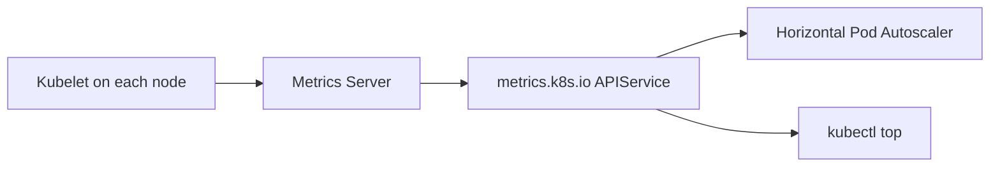

# Kubernetes Metrics Server: install and verify

Metrics Server provides the Kubernetes resource metrics API (`metrics.k8s.io`) used by `kubectl top` and CPU/memory Horizontal Pod Autoscalers (HPAs). It is **not** Prometheus, a historical monitoring system or a fix for GitLab application init-container failures.

Use this on an **existing Kubernetes cluster**, with nodes and networking already installed. The baseline below is a **kind learning lab** on Kubernetes v1.34.11. Do not assume kind is running on any specific host. The lab-only TLS override must not be reused in managed or production Kubernetes.

## Architecture



## Pseudocode

```text
CHECK intended Kubernetes context
CHECK whether Metrics Server is already installed
IF not installed: add official Helm repository
INSTALL pinned chart and app image, add kubelet TLS override only on kind
VERIFY Deployment, APIService and kubectl top
CHECK GitLab HPAs again; treat init-container issues separately
```

## 1. Inspect before installing

```bash
kubectl config current-context
kubectl get nodes
helm list -n kube-system
kubectl get apiservice v1beta1.metrics.k8s.io --ignore-not-found
```

Skip the installation if Metrics Server already exists. Inspect the existing deployment's owner (Helm or other) rather than installing a competing copy.

## 2. Install on a disposable kind lab

The chart version is pinned at `3.14.0` and Metrics Server image at `v0.9.1`. Metrics Server 0.9.x supports Kubernetes v1.34+. The chart default is an earlier 0.9.0 image, so the explicit tag selects 0.9.1.

```bash
helm repo add metrics-server https://kubernetes-sigs.github.io/metrics-server/
helm repo update metrics-server

helm upgrade --install metrics-server metrics-server/metrics-server \
  --version 3.14.0 \
  --namespace kube-system \
  --set image.tag=v0.9.1 \
  --set 'args[0]=--kubelet-insecure-tls' \
  --wait --timeout 5m
```

**Why the flag?** kind kubelets generally use serving certificates that Metrics Server cannot validate against a trusted CA. `--kubelet-insecure-tls` bypasses only the kubelet serving-certificate check and is **lab-only**. In a secure cluster, use valid kubelet serving certificates instead. Do not disable TLS verification as a generic production fix.

**What the Helm command does:** Install Metrics Server in `kube-system`, register its aggregated Metrics API via APIService, and create the service, Deployment and permissions. It does not alter GitLab chart values or install a monitoring database.

## 3. Verify

```bash
kubectl -n kube-system rollout status deployment/metrics-server --timeout=180s
kubectl get apiservice v1beta1.metrics.k8s.io
kubectl top nodes
kubectl top pods -n gitlab
kubectl -n gitlab get hpa
```

Expected: APIService available and CPU/memory values appear in `kubectl top`. HPA warnings about missing `pods.metrics.k8s.io` should stop after metrics become available. If not, inspect only the Metrics Server APIService and Pod logs:

```bash
kubectl -n kube-system get pods -l app.kubernetes.io/name=metrics-server
kubectl -n kube-system logs deployment/metrics-server --tail=80
kubectl describe apiservice v1beta1.metrics.k8s.io
```

**GitLab note:** Metrics Server addresses missing HPA metrics, **not** `PodInitializing`, application migration or container restart errors. Diagnose those with the Pod's init-container state and events.

## 4. Production adaptation

Do not reuse the `--kubelet-insecure-tls` argument on EKS/GKE or a production cluster without a reviewed exception. Prefer the platform's managed Metrics Server support or validate the cluster's CA and kubelet serving certificates. Use a target-owned chart release with pinned versions and a lifecycle plan.

## References

- https://github.com/kubernetes-sigs/metrics-server
- https://github.com/kubernetes-sigs/metrics-server/releases/tag/v0.9.1
- https://github.com/kubernetes-sigs/metrics-server/releases/tag/metrics-server-helm-chart-3.14.0
