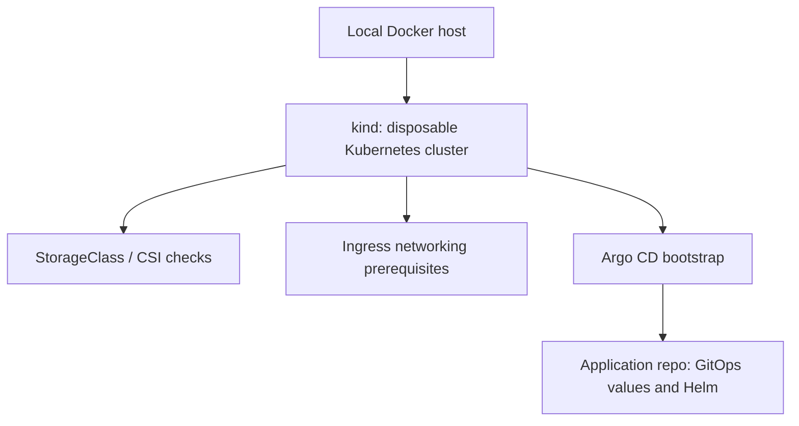

# Create the Certificates

```bash
NAME=konark
CLUSTER_NAME=$NAME-cluster
HOST=$NAME.local.com
APP_NAME=$NAME-app
NAMESPACE=$NAME-demo
echo $CLUSTER_NAME, $HOST,$APP_NAME,$NAMESPACE

mkdir ${APP_NAME}
cd ${APP_NAME}

```

# Create KIND cluster

```bash
mkdir -p $NAME
cd $NAME
cat > ${CLUSTER_NAME}-config.yaml <<EOF
kind: Cluster
apiVersion: kind.x-k8s.io/v1alpha4
name: ${CLUSTER_NAME}
nodes:
- role: control-plane
  image: kindest/node:v1.22.2
  extraPortMappings:
  - containerPort: 80
    hostPort: 80
  - containerPort: 443
    hostPort: 443
  - containerPort: 1024
    hostPort: 1024
- role: worker
  image: kindest/node:v1.22.2
- role: worker
  image: kindest/node:v1.22.2
- role: worker
  image: kindest/node:v1.22.2
EOF

kind create cluster --name ${CLUSTER_NAME} --config ${CLUSTER_NAME}-config.yaml

kubectl cluster-info --context kind-${CLUSTER_NAME}

kubectl label nodes ${CLUSTER_NAME}-control-plane ingress-ready="true"

```

# Deploy ingress controller

```
kubectl apply -f https://raw.githubusercontent.com/kubernetes/ingress-nginx/main/deploy/static/provider/kind/deploy.yaml
kubectl get pod -n ingress-nginx
```

# Deploy Storage class

```bash
kubectl apply -f https://raw.githubusercontent.com/rancher/local-path-provisioner/master/deploy/local-path-storage.yaml
# For tetsing
kubectl create -f https://raw.githubusercontent.com/rancher/local-path-provisioner/master/examples/pvc/pvc.yaml
kubectl create -f https://raw.githubusercontent.com/rancher/local-path-provisioner/master/examples/pod/pod.yaml
kubectl get pv
kubectl get pvc
kubectl exec volume-test -- sh -c "echo local-path-test > /data/test"
kubectl exec volume-test -- sh cat /data/test

ssh <kubernetes node ip>
$ ls /var/lib/rancher/k3s/storage/

```

# Build a sample application

```bash
# Create an index page

cat > index.html <<EOF
<!DOCTYPE html>
<html>
<body>

</body>
</html>
EOF

# An Error Page

cat > error.html <<EOF
<!DOCTYPE html>
<html>
<body>
<p style="color:red;">You don't have access to this page at ${HOST} </p>
</body>
</html>
EOF

# Dockerfile to build the image

cat > Dockerfile <<EOF
FROM nginx:alpine
COPY . /usr/share/nginx/html
EOF

# Build the image and load into kind cluster

docker build -t ${APP_NAME}:0.0.1 .
kind load docker-image ${APP_NAME}:0.0.1 --name ${CLUSTER_NAME}

```

# Create k8s manifest files

```bash
# Create namespace

kubectl create ns ${NAMESPACE}

cat > ${APP_NAME}.yaml <<EOF
kind: Pod
apiVersion: v1
metadata:
  name: ${APP_NAME}
  labels:
    app: ${APP_NAME}
spec:
  containers:
  - name: ${APP_NAME}
    image: ${APP_NAME}:0.0.1
---
# Create Service
kind: Service
apiVersion: v1
metadata:
  name: ${APP_NAME}
spec:
  selector:
    app: ${APP_NAME}
  ports:
  - port: 80
---

# Create Ingress

apiVersion: networking.k8s.io/v1
kind: Ingress
metadata:
  name: ${APP_NAME}
spec:
  rules:
  - host: ${HOST}
    http:
      paths:
      - pathType: Prefix
        path: "/"
        backend:
          service:
            name: ${APP_NAME}
            port:
             number: 80
  tls:
  - hosts:
      - ${HOST}
    secretName: ${APP_NAME}-tls

EOF
```

# Apply the Manifest file

```bash
k create -f ${APP_NAME}.yaml -n ${NAMESPACE}

# Create the TLS Secret
cd ..
kubectl create secret generic ${APP_NAME}-tls --from-file=tls.crt=${HOST}.crt --from-file=tls.key=${HOST}.key --from-file=ca.crt=ca.crt -n ${NAMESPACE}

curl -ks https://$HOST

```

# Special Notes

```bash
echo "127.0.0.1 ${HOST}" >> /etc/hosts
for windows update the same line in "C:\Windows\System32\drivers\etc\hosts file"

```

# Create Certificates inside a container (Optional)

```bash
docker run -it --rm -e HOST=${HOST} -v ${HOME}:/root/ -v ${PWD}:/work -w /work --net host quay.io/jitesoft/alpine:3.17.1 sh
apk add openssl
openssl req -x509 -sha256 -newkey rsa:4096 -keyout ca.key -out ca.crt -days 356 -nodes -subj "/CN=${HOST} Cert Authority"
openssl req -new -newkey rsa:4096 -keyout ${HOST}.key -out ${HOST}.csr -nodes -subj "/CN=${HOST}"
openssl x509 -req -sha256 -days 365 -in ${HOST}.csr -CA ca.crt -CAkey ca.key -set_serial 01 -out ${HOST}.crt
```

# Delete the cluster

```bash
kind delete clusters ${CLUSTER_NAME}

```


---

# Reusable kind cluster setup for local GitOps labs

> The sections above preserve the original `konark-cluster` exercise as a
> historical example. Its Kubernetes node image, floating remote manifests,
> example certificates and installation commands should **not** be reused
> unreviewed for a new cluster.
>
> This section is the canonical **cluster infrastructure** guide for future
> local labs, including GitLab. Application deployment stays in the
> application repository. No local cluster was created by this documentation.

## Ownership and boundary



- **This repository (`nks`) owns:** kind installation/upgrade guidance,
  cluster config, container runtime prerequisites, storage/ingress review,
  Kubernetes context safety, lifecycle and teardown.
- **Application repositories own:** application Helm charts, Argo CD
  Application definitions, platform-specific values, passwords/Secret
  references, and application validation.
- Any existing kind cluster is separate from this guide. Do not infer its
  identity or configuration from examples; always select a context explicitly.
- Do not run these commands until the target cluster config and resource
  requirements have been reviewed and installation approved.

## 1. Review existing local prerequisites (read only)

```bash
docker version
docker info
kind version
kubectl version --client
kind get clusters
kubectl config get-contexts
docker ps --format 'table {{.Names}}\t{{.Image}}\t{{.Ports}}'
df -h .
```

Check that your host has adequate CPU, RAM and disk available before starting
a resource-heavy application. GitLab is considerably heavier than a basic
nginx example. A preliminary **planning target**, not a supported GitLab
minimum, is 8 logical CPUs, 16 GiB free RAM and 50 GiB free disk; verify
actual Helm chart resource requests and local usage before deploying.

## 2. Dedicated disposable cluster configuration

The example cluster name is `gitlab-lab`. The canonical configuration is
[docs/kind-gitlab-lab-config.yaml](kind-gitlab-lab-config.yaml).

It uses one control plane and one worker, a pinned Kubernetes node image,
a loopback-accessible API, and no public ingress port mappings.
Review the node-image digest and kind version against the current upstream
release before provisioning. This is a **lab-only** topology, not HA.

After approval:

```bash
# Run from the root of the nks checkout.
kind create cluster --config docs/kind-gitlab-lab-config.yaml
```

The creation command makes local Docker containers, a Kubernetes control
plane and a kubeconfig context. It does not create AWS resources.

## 3. Verify the new cluster and its default storage

```bash
kubectl --context kind-gitlab-lab get nodes -o wide
kubectl --context kind-gitlab-lab get storageclass
kubectl --context kind-gitlab-lab get pods -A
```

Confirm there is an appropriate default StorageClass and test a disposable
PVC before provisioning stateful workloads. **Do not** install an unpinned
Rancher local-path provisioner from `master` without confirming why it is
required. Avoid applying overlapping CSI/StorageClass installations.

## 4. Ingress, DNS and local access

Choose **one** ingress installation method. If the application GitOps stack
uses an Argo CD-managed ingress-nginx Helm chart, do not also apply the
historical `provider/kind/deploy.yaml` manifest.

The GitLab local stack uses a ClusterIP ingress controller and explicit local
port-forwards rather than host port 80/443 mappings:

```bash
kubectl --context kind-gitlab-lab -n ingress-nginx \
  port-forward svc/ingress-nginx-controller 8443:443
```

Run this only after that Service is installed. Local DNS/hosts entries, TLS
trust and SSH port-forwarding must be configured for the specific application
and are not cluster provisioning steps.

## 5. Argo CD control plane

After installing and reviewing Argo CD for the selected context,
the application repo can register its root Application.
Bootstrap requires separate approval because Argo CD installs CRDs and
cluster RBAC. Keep Git repository credentials outside this document
and outside Git.

GitLab-specific App-of-Apps documentation:
[GitLab kind stack](https://github.com/naren4b/learn-gitlab/blob/main/k8s/gitops/stacks/kind.yaml)
and
[GitLab root Application](https://github.com/naren4b/learn-gitlab/blob/main/k8s/gitops/root-gitlab-kind.yaml).

## 6. Clean up safely

Only after explicit confirmation that data can be lost:

```bash
kind get clusters
# Destroys the selected disposable cluster and its Kubernetes data.
kind delete cluster --name gitlab-lab
kind get clusters
docker ps --format 'table {{.Names}}\t{{.Image}}'
```

Do not run global Docker system pruning, and do not delete another cluster.
Check Docker volumes, image usage and any remaining local port-forward
processes separately. Backup any application data before destruction.

Reference: https://kind.sigs.k8s.io/docs/user/configuration/
