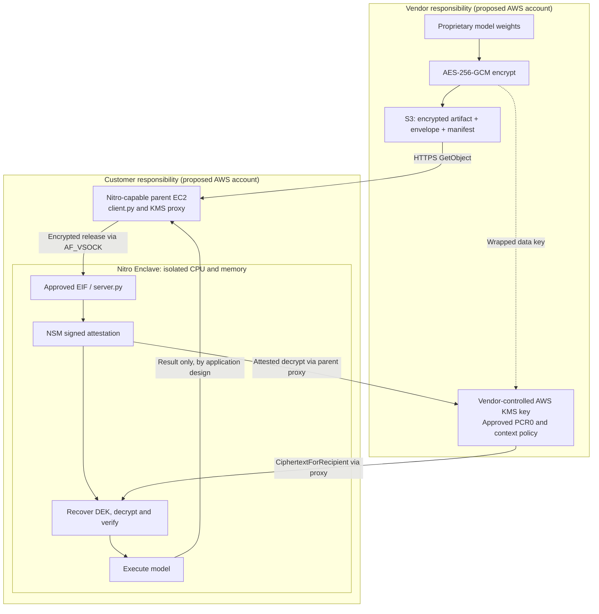
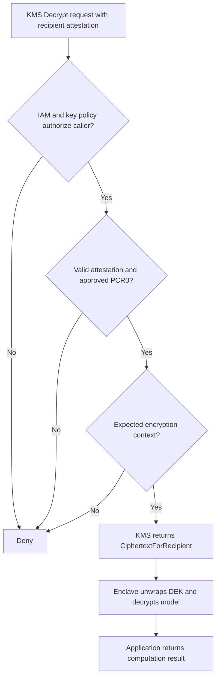

# Protecting AI Model Weights with AWS Nitro Enclaves and KMS Attestation

Published: 2026-10-20

Can an AI model vendor let a customer run its model on customer-owned infrastructure without handing the customer the plaintext model weights? This hands-on architecture study explores encrypted model distribution, isolated execution, and **attestation-gated decryption** using AWS Nitro Enclaves and AWS Key Management Service (KMS).

**Evidence boundary:** The completed learning lab used **one AWS account** to simulate the vendor and customer, a **2×2 SafeTensors matrix** with NumPy computation, and an `m6i.xlarge` instance in `ap-south-1`. It was **not** a real LLM, a production banking integration, or a tested two-account deployment. The two-account design below is a proposal based on the tested components.

## The question behind the architecture

A model vendor wants to protect its model intellectual property. A customer wants to control infrastructure and execute the model in its own environment. Encrypting a downloadable model is easy. The harder question is: **who may recover the decryption key, and under what conditions?**

IAM authorization alone identifies a permitted caller. It does not, by itself, prove that the intended isolated application is running. This design adds recipient attestation: KMS considers signed evidence from the Nitro Security Module (NSM) and an approved Enclave Image File (EIF) measurement before returning a key response protected for that enclave.

## What was built

- **Release:** A tiny SafeTensors model encrypted using AES-256-GCM, with an envelope and manifest stored in Amazon S3.
- **Key control:** AWS KMS generated the data-encryption key (DEK); the wrapped DEK was distributed with the encrypted artifact.
- **Runtime:** A Nitro-capable parent EC2 instance ran `client.py`; an isolated Nitro Enclave ran `server.py` and `kmstool-enclave-cli`.
- **Communication:** The parent retrieved objects from S3 over HTTPS, passed encrypted data via AF_VSOCK, and relayed enclave KMS requests through a vsock proxy to KMS over HTTPS.
- **Validation:** The enclave recovered the DEK, decrypted and SHA-256-verified the model, ran a small NumPy calculation, and returned the result. The observed happy-path output was `PASS`, `[-0.75, 2.75]`.

## Architecture: proposed vendor and customer ownership

This is the **proposed two-account separation**, not the account layout exercised in the lab.

**Trust boundary:** The enclave has no ordinary IP address or external network interface. Its requests to KMS travel through the parent instance's vsock proxy. A vsock channel identifier routes traffic; it is **not** cryptographic proof of the enclave's identity.

## How attested key release works

1. The vendor prepares and encrypts model bytes with a DEK, and distributes the encrypted model plus wrapped DEK.
2. The parent EC2 instance downloads the **encrypted** release and passes it to the enclave over AF_VSOCK.
3. The enclave obtains NSM-signed evidence associated with its recipient key and requests KMS Decrypt through the parent proxy.
4. KMS evaluates the caller, key policy, approved PCR0 measurement, and expected encryption context.
5. On the authorized path, KMS returns `CiphertextForRecipient`. The DEK and plaintext model are recovered **inside the enclave**, not exposed as plaintext through the KMS proxy.
6. The enclave verifies the artifact and computes the output. Only the result is returned by this sample application.

**Measured identity is not a security audit.** A matching PCR0 identifies approved measured image contents; it does not prove those contents are free from vulnerabilities, malicious behavior, or output leakage.

## Lab evidence versus production claims

| Area | Completed lab | Not yet proven |
| --- | --- | --- |
| Ownership | Logical vendor/customer roles in one AWS account | Real cross-account access and independent ownership |
| Model | Tiny 2×2 SafeTensors matrix | LLM inference, model memory sizing, throughput |
| Runtime | `m6i.xlarge`, Nitro Enclave, Python/NumPy | GPU-based enclave inference; Nitro Enclaves have no direct GPU access |
| Protection | KMS PCR0 restriction and recipient-attested happy path | Complete deny/fail-closed test matrix and threat model |
| Networking | HTTPS to S3/KMS through parent; local AF_VSOCK | PrivateLink-only design, public API, user authentication |
| Response | Calculation result returned | Customer prompt privacy and resistance to output leakage |

The lab did **not** establish vendor-signed model provenance, authenticated client-to-enclave application communication, guaranteed memory zeroization, or continuous enforcement after a key is released.

## Production architecture decisions

Before adopting this pattern for an enterprise AI product, address these questions:

1. **Who approves enclave software?** Define who builds the EIF, validates its measurement, approves PCR changes, and revokes old releases.
2. **Who controls the key?** Design vendor/customer cross-account KMS and S3 policies, including least privilege and encryption-context constraints.
3. **What does the enclave protect?** Specify the threat model. Weight confidentiality, user prompt confidentiality, and secure outputs are different properties.
4. **Can the model run there?** Nitro Enclaves are CPU-only without direct GPU access. Test real model memory, latency, cost, and concurrency.
5. **What can still leak?** Review application code, output behavior, logging, monitoring, and operational recovery. Attestation does not eliminate these risks.

From an AWS Well-Architected perspective, this design primarily addresses **Security** through key policy and isolated execution. **Operational Excellence** needs a controlled EIF release process and auditable PCR approvals. **Performance Efficiency** and **Cost Optimization** require real inference measurements before selecting this architecture.

## Key takeaway

The key design change is not merely encrypting the model. It is tying **permission to recover its key** to an **approved, measured execution environment**. That creates a stronger control than giving the runtime general-purpose decrypt access, but the security guarantee remains bounded by the enclave application and the threat model.

## Source architecture and lab notes

The detailed learning repository contains the [complete architecture, diagrams, network paths, security decisions, and tested-versus-proposed boundaries](https://github.com/naren4b/learn-aws/blob/main/docs/attestation/complete-architecture.md). For the executable lab, see the [completed enclave application and runbook](https://github.com/naren4b/learn-aws/tree/main/labs/attestation-real-model/final-enclave).

**Next learning checkpoint:** Test a genuine cross-account vendor/customer design and one authenticated request through a real CPU-compatible model, with explicit prompt-data controls and negative KMS-policy tests.
