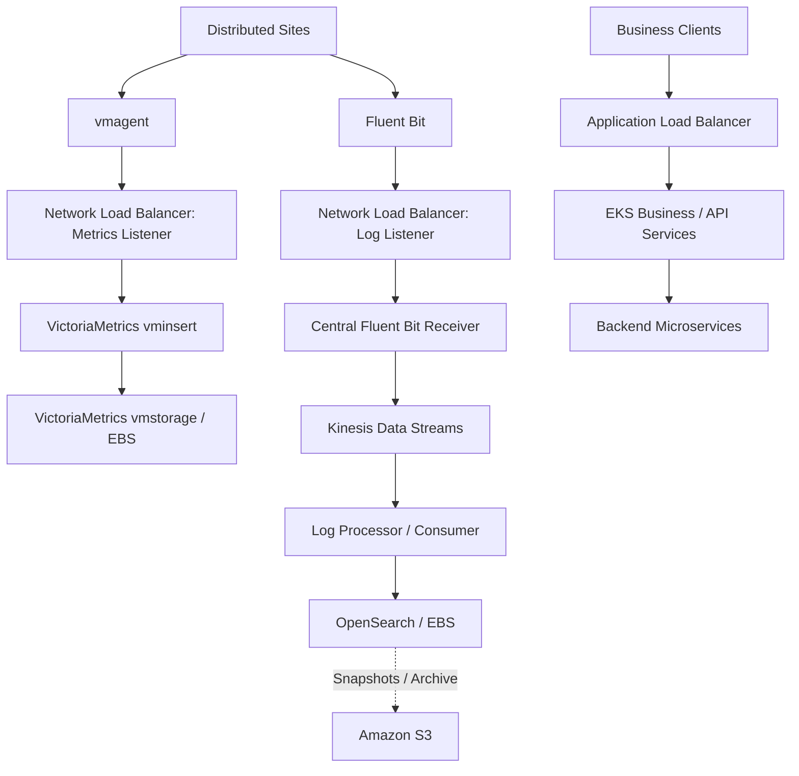

# Architecting Secure and Scalable Telemetry on AWS for Distributed Sites

Published: 2026-08-21

Distributed sites often send metrics and logs into a central cloud platform while customers and operators access business applications separately. These workloads should not be forced through one processing path.

This article adapts my [LinkedIn architecture discussion](https://www.linkedin.com/pulse/architecting-secure-scalable-telemetry-aws-sites-narendranath-panda-qd19c/) into a design reference. It is a **solution architecture**, not a claim that every component and failure scenario has been deployed or tested as shown.

## Objective

Explain how to choose scalable AWS ingress, processing, security and storage boundaries for telemetry originating in many distributed Kubernetes sites. Compare the trade-offs behind direct metrics ingestion, buffered logging and independent business access.

## Reference architecture

Metrics and logs may share one Network Load Balancer through different listeners and target groups. The Application Load Balancer serves application-level HTTP or gRPC traffic independently.

## Choose the path for each workload

| Workload | Architecture | Reason |
| --- | --- | --- |
| Business applications | ALB → EKS applications | Application-level routing and separation from telemetry spikes |
| Metrics | vmagent → NLB → VictoriaMetrics | Keep the existing purpose-built ingestion path simple |
| Logs | Fluent Bit → NLB → central receiver → Kinesis → processor → OpenSearch | Decouple bursty ingestion from parsing, indexing and storage |

A common ingress does **not** imply a common processing pipeline. Network Load Balancers operate at Layer 4, so separate listeners or ports, rather than HTTP paths, distinguish the two telemetry streams.

## 1. Network and service discovery

Use a stable DNS name for distributed agents instead of embedding individual load balancer node IPs. Where remote firewalls require fixed allow-listed addresses, evaluate the load balancer's static IP or Elastic IP options.

The telemetry receiver should be the exposed entry point. Internal processing and storage do not need direct internet exposure.

## 2. Keep metrics ingestion simple

When distributed sites already use `vmagent`, a direct path to VictoriaMetrics `vminsert` is often appropriate. Adding an unrelated streaming system to this path can increase latency, operational work and cost without solving a real requirement.

Plan the metrics path for ingestion rates, remote-write behavior, replica availability, storage capacity, retention and query pressure.

## 3. Buffer logs where it matters

After a network interruption, many remote sites can reconnect and forward accumulated logs simultaneously. A streaming buffer between ingestion and processing helps separate short-term bursts from downstream indexing throughput.

In the proposed design, Kinesis Data Streams supplies this boundary. Consumers can process at their own rate and replay within the configured stream retention window. Buffering has limits and cost. It does not remove the need to size the stream or manage failed records.

A central Fluent Bit receiver also keeps AWS connectivity and authorization concentrated in the receiving platform, rather than requiring each remote site to obtain direct access to Kinesis.

## 4. Process data before indexing

A consumer can validate schemas, detect malformed records, enrich trusted site or tenant metadata, handle sensitive fields and build the OpenSearch document structure.

The implementation needs explicit choices for retries, duplicate delivery, poison records, failed exports and backpressure. Tenant labels alone do not establish authorization. Separate query and export access controls are still required.

## 5. Private connectivity and security

The central receiver and processor can run in private EKS subnets and reach Kinesis through an interface VPC endpoint. For suitable S3 access, a gateway endpoint can avoid unnecessary outbound internet routing.

An endpoint provides network connectivity. It is not a substitute for IAM authorization, data validation or application-level security.

Protect ingestion with appropriate TLS, and use mutual TLS when site identity must be verified through client certificates. Choose TLS termination or passthrough according to where that validation occurs.

## 6. Design independent scaling and failure boundaries

| Layer | Capacity or failure question |
| --- | --- |
| Ingress | How many sites, connections and reconnects can arrive together? |
| Metrics | Can ingestion and storage handle bursts and query load? |
| Log receiver | Can it accept records without exhausting memory or disk buffers? |
| Kinesis | Are stream throughput, shard or capacity limits and consumer lag within bounds? |
| Processing | Can consumers scale safely while preserving record handling rules? |
| OpenSearch | Can indexing, search and storage scale independently? |
| Business services | Are application resources protected from telemetry spikes? |

Use multiple Availability Zones where the service and stateful topology support it. Actual recovery objectives depend on the chosen replication, pod placement, capacity and storage design.

## 7. Cost and retention decisions

Not all telemetry needs permanent searchable storage. Define retention separately for operational metrics, searchable logs, snapshots and archives, based on troubleshooting, customer and compliance needs.

Consider ingestion and indexing charges, Kinesis capacity, OpenSearch storage, EBS volumes, snapshot retention, load balancing and VPC endpoint charges. Do not add an intermediary only because it is available as a managed service.

## Alternatives and trade-offs

| Decision | Simpler option | Choose extra components when |
| --- | --- | --- |
| Metrics transport | vmagent directly into VictoriaMetrics | A new transport solves a measured reliability or processing requirement |
| Log transport | Fluent Bit directly into the backend | Reconnection bursts, processing isolation or replay justify streaming |
| Remote-site AWS access | Central network receiver | Direct cloud access has acceptable connectivity, identity and lifecycle controls |
| Connectivity | Public ingress secured with TLS | Private network links are required and practical |
| Retention | Searchable hot storage | Archive and snapshot tiers reduce long-term cost while meeting recovery obligations |

## AWS Well-Architected perspective

- **Security:** Limit public exposure, encrypt traffic, use workload identity and enforce data access boundaries.
- **Reliability:** Isolate the three workloads, test reconnect storms and plan multi-AZ recovery.
- **Performance efficiency:** Scale collection, buffering, processing and storage according to their own workloads.
- **Cost optimization:** Keep the metrics path lean, justify streaming costs and set clear retention policies.
- **Operational excellence:** Monitor the telemetry system itself, including dropped records, consumer lag, queue pressure and storage saturation.
- **Sustainability:** Avoid permanent overprovisioning for occasional bursts.

## Key takeaways

A resilient telemetry design is not the one with the most services. Each component should have a clear responsibility. Separate traffic paths where their operational behavior differs, use buffering only when it adds value, retain data intentionally and keep processing and storage behind explicit security boundaries.

## Original article

[Architecting Secure and Scalable Telemetry on AWS for Distributed Sites, LinkedIn, August 21, 2026](https://www.linkedin.com/pulse/architecting-secure-scalable-telemetry-aws-sites-narendranath-panda-qd19c/)
